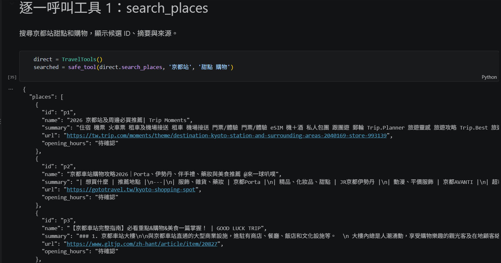
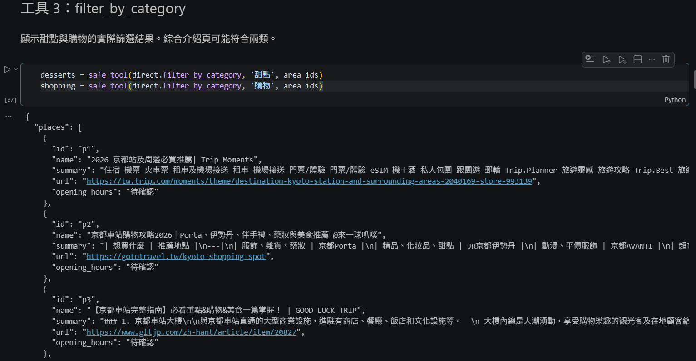
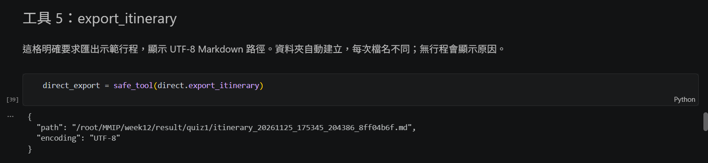
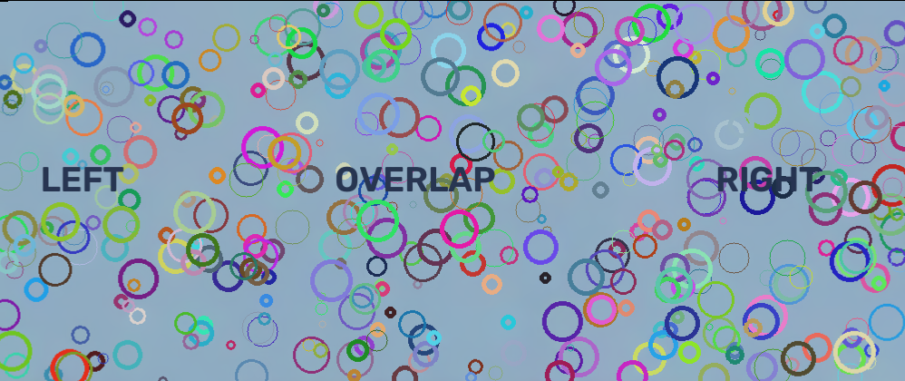

# quiz 1

第十二堂作業一「旅遊行程助手」原先用 Groq 執行模型。測試四題和六組比較時，多輪工具呼叫累積的 token 用量觸發免費方案限流，部分題目跑到一半就收到 HTTP 429，因此改由 MMIP 的 Python 透過 Transformers 在本機載入 Hugging Face 的 Qwen3 權重。

本文件整理作業的工具、執行紀錄與成果。[main.ipynb](./main.ipynb) 附有可重跑的展示和完整輸出。本機模型根據需求選工具，由 Python 呼叫 Tavily 搜尋、排行程或存檔。模型推論不使用 Groq 額度，網路搜尋仍使用 Tavily 的額度。

## 五個工具

### `search_places`



使用 Tavily 的 basic 搜尋查找候選。這次傳入區域「京都站」和關鍵字「甜點 購物」，回傳 `p1`～`p5` 共五筆候選，包含名稱、摘要和來源網址，營業時間標為「待確認」。

### `filter_by_area`


依來源文字從已有候選篩選區域。這次傳入「京都站」，回傳 `p1`～`p5`，五筆都符合文字篩選條件。Notebook 再從回傳清單取出候選 ID，存成 `area_ids`。

### `filter_by_category`



依活動類別篩選候選。這次把 `area_ids` 分別搭配「甜點」和「購物」呼叫兩次。Notebook 完整輸出顯示，甜點回傳 `p1`～`p5`，購物回傳 `p2`～`p5`。

### `build_itinerary`


依可用時間和活動順序排程。這次傳入 120 分鐘，指定 `p1` 吃甜點 45 分鐘、`p2` 購物 55 分鐘。回傳的行程為 14:00–14:45 吃甜點、14:55–15:50 購物，含 10 分鐘移動共用 110 分鐘，沒有未排入的站點。

### `export_itinerary`



將最近一次排好的行程和來源存成 Markdown。這次呼叫不需傳入參數，回傳檔案路徑（相對於 README 為 `result/quiz1/itinerary_20261125_175345_204386_8ff04b6f.md`）和編碼 `UTF-8`。

工具與 Agent 迴圈放在 [other_code/quiz1.py](./other_code/quiz1.py)。Notebook 會顯示工具名稱、參數、回傳結果、耗時和來源。

## ReAct 流程與工具觀察

這份作業用 Qwen3 的聊天模板實作 ReAct。模型產生工具名稱和參數，Python 執行後把結果交回模型，模型再根據結果決定下一步。例如在 B1，模型可以先搜尋京都站附近的候選地點，再依搜尋結果篩選或排行程，最後按使用者要求匯出。

最初執行 A1、A2、B1、B2 時，「五工具覆蓋檢查」顯示四題合計用了四個工具，缺少 `filter_by_area`。搜尋關鍵字包含「京都站」，但工具紀錄裡沒有實際的區域篩選呼叫。

因此在 A1 的提示中明確要求模型呼叫 `filter_by_area` 確認京都站。重跑後，工具紀錄顯示模型確實以 `area="京都站"` 呼叫了該工具。

### 模型可呼叫的函數與實際覆蓋

Quiz 1 每輪把 `TOOLS` 裡的 **5 個函數定義**交給 Qwen3 的聊天模板，包括 `search_places`、`filter_by_area`、`filter_by_category`、`build_itinerary` 和 `export_itinerary`。定義中包含用途與參數，模型可以依題目選用。這是[程式註冊的工具清單](./other_code/quiz1.py#L127)；四題實際成功呼叫了哪些工具，另由 Notebook 的「五工具覆蓋檢查」統計。

```text
成功呼叫: ['build_itinerary', 'export_itinerary', 'filter_by_area', 'filter_by_category', 'search_places']
尚缺: []
```

### 任務成果與失敗案例

- **B1 成功匯出。** 使用工具排出甜點 30 分鐘、移動 15 分鐘、購物 45 分鐘，共 90 分鐘，沒有未排入的站點。時間以[實際匯出的 Markdown](./result/quiz1/itinerary_20261125_175430_207257_3913f8bf.md) 為準。
- **B2 在類型篩選後停止。** 題目用「甜點、購物」描述兩個活動，模型把整串文字當成單一 `category` 傳給 `filter_by_category`。工具用單一類型做文字篩選，這次回傳空清單 `places: []`。後續沒有呼叫 `build_itinerary` 或 `export_itinerary`，所以沒有行程檔。這次失敗說明兩種活動需要拆成兩次篩選。
- **A1、A2 有搜尋和來源紀錄。** 兩題的最終回答都停在「未要求存檔」的提醒，沒有整理甜點店建議。五工具覆蓋是四題合計，單題是否完成仍須看回答與成果。

## 進階比較結果與觀察

下表整理 [main.ipynb](./main.ipynb) 已儲存的六組比較結果。

| 模型 | 提示技巧 | 工具呼叫次數 | 耗時（秒） | 完成 |
| --- | --- | ---: | ---: | --- |
| Qwen3-1.7B | 直接指令 | 8 | 20.4 | False |
| Qwen3-1.7B | 角色與輸出要求 | 7 | 26.876 | False |
| Qwen3-1.7B | 單一示範案例 | 7 | 20.63 | False |
| Qwen3-0.6B | 直接指令 | 5 | 17.163 | False |
| Qwen3-0.6B | 角色與輸出要求 | 5 | 8.214 | False |
| Qwen3-0.6B | 單一示範案例 | 5 | 7.765 | False |

六組的工具順序都列出五種工具，包含 `build_itinerary` 和 `export_itinerary`。這只表示模型曾嘗試呼叫，排程和匯出是否成功須看各工具的回傳結果。耗時是這次各組的執行紀錄，單憑耗時無法判斷模型或提示技巧的優劣。

[compare()](./other_code/quiz1.py#L221) 要求以下條件全部成立才算完成。

- 整輪沒有錯誤，且有最終回答。
- 有匯出紀錄。
- 最後一次排程沒有省略任何站點，估計總耗時不超過 120 分鐘。
- 行程至少有兩站，前兩站的活動依序符合「甜點」和「購物」。
- 工具呼叫紀錄包含全部五種工具。

六組皆未通過完成判定。Qwen3-1.7B 的「直接指令」組有逐輪紀錄。兩次排程都要求甜點 30 分鐘、移動 15 分鐘、逛街 90 分鐘，合計 135 分鐘，超出 120 分鐘預算，因此最後一次排程也只保留甜點一站，逛街被列為未排入。匯出工具有回傳 Markdown 路徑，但這組未滿足「沒有省略站點」及「至少兩站」的條件。其餘五組只保留比較摘要，現有紀錄不足以確認各組未通過的項目。

## 環境設定與執行

在專案根目錄開啟 PowerShell，用 Conda 的 **MMIP (Python 3.13.13)** 安裝 [requirements.txt](./requirements.txt) 列出的依賴。

```powershell
conda run -n MMIP python -m pip install -r ./requirements.txt
```

`httpx` 負責 API 請求，`python-dotenv` 讀取環境變數，`ipykernel` 提供 Notebook kernel，`nbformat` 和 `nbclient` 用於 Notebook 驗證，`pypdf` 用於讀取講義。

沿用 MMIP 中已有的 PyTorch。Notebook 會透過 `from_pretrained` 載入模型。第一次執行某個模型會從 Hugging Face 下載權重到預設快取（使用者家目錄下的 `.cache/huggingface/hub`），之後會重用。Windows 上權重下載會驗證 HTTPS 憑證並使用系統信任的憑證。模型一次載入一個。顯示記憶體不夠時會改用 CPU，速度可能較慢。

在專案根目錄的 `./.env` 設定 Tavily 金鑰。

```dotenv
TAVILY_API_KEY=你的Tavily金鑰
```

`.env` 已列入 `.gitignore`。Tavily 使用 `search_depth="basic"`。

`MODEL` 預設為 `Qwen/Qwen3-1.7B`，進階比較另用 `Qwen/Qwen3-0.6B`。只重跑比較時，執行「設定與匯入」、「兩個模型 × 三種提示技巧」和「討論六組結果與解讀 ReAct」即可。六組共用同一份真實搜尋結果，已有工具展示的候選就沿用，否則只搜尋一次。

## 匯出與驗證

行程會存到 `./result/quiz1/itinerary_*.md`。每次匯出使用不同檔名，方便保留各次結果。

可用以下指令重跑離線測試。

```powershell
conda run -n MMIP python -m unittest other_code.test_quiz1 -v
```

# quiz 2

多模態影像 Agent 使用官方 [Qwen/Qwen2.5-VL-3B-Instruct](https://huggingface.co/Qwen/Qwen2.5-VL-3B-Instruct)，透過 Transformers 在 MMIP Notebook kernel 的 CUDA GPU 上推論。模型接收實際圖片與文字指令，每輪依工具回傳和影像決定下一個動作。影像處理由 Python 和 OpenCV 執行，工具與 Agent 放在 [other_code/quiz2.py](./other_code/quiz2.py)。

## 影像工具

| 工具 | 用途 |
| --- | --- |
| `match_exposure` | 以參考照片的平均亮度為基準校正另一張照片，回傳新圖片 ID、尺寸、亮度增益與校正前後的亮度。 |
| `stitch_images` | 以 OpenCV 對齊並拼接同一場景有重疊的照片。成功時回傳全景圖片 ID 與尺寸，失敗時回傳 OpenCV 狀態與原因。 |
| `save_image` | 依處理後的圖片 ID 存成 PNG，回傳檔案路徑與尺寸。 |
| `get_local_photos` | 從指定的本機資料夾取得可讀照片，回傳檔名、相對路徑與圖片 ID。 |

### 模型可呼叫的函數與實際執行

Quiz 2 會把註冊工具的名稱和用途寫入 Qwen2.5-VL 的系統提示。以下數量來自兩次執行輸出的 `registered_tools`，右欄是該次紀錄中模型實際成功呼叫的函數。五個旅遊工具仍列於清單中，這次照片任務只授權執行影像工具。

| 展示 | 註冊給模型的工具 | 實際成功呼叫 |
| --- | --- | --- |
| **8 工具版**：指定兩張照片 | Quiz 1 的 5 個工具，加上 `match_exposure`、`stitch_images`、`save_image`。 | `match_exposure` → `stitch_images` → `save_image` |
| **9 工具版**：指定資料夾 | 上述 8 個，再加 `get_local_photos`。 | `get_local_photos` → `match_exposure` → `stitch_images` → `save_image` |

9 工具版會列出可讀候選，並傳入檔名排序的前八張供模型看圖。本次紀錄中，模型第一輪只收到資料夾，取得照片後第二輪收到兩張圖。下圖是這次用合成影像拼出的全景。



## 照片、模型與執行方式

1. 將同一場景有重疊的正式照片放在 `data/quiz2/`。在 [main.ipynb](./main.ipynb) 末尾的 Quiz 2 執行「設定照片」。正式展示時，將 `q2_use_synthetic` 設為 `False`，並把 `q2_names` 設成兩張照片的檔名。若只跑 9 工具版，只需設定 `q2_folder` 並將 `q2_names` 設為空 tuple `()`。預設的合成測試影像放在 `data/quiz2/_synthetic/`。
2. 依序執行「直接呼叫 1：亮度校正」、「直接呼叫 2：全景拼接」與「直接呼叫 3：PNG 存檔」，可查看各格的實際參數、回傳與預覽。
3. 執行「載入視覺語言模型」，再執行「8 工具版：指定兩張照片」與「9 工具版：只指定資料夾」。最後的 PNG 都存到 `result/quiz2/`。

首次載入會從 Hugging Face 官方模型庫下載權重與 processor。模型檔、下載暫存和 CUDA 快取都放在 `.cache/quiz2/huggingface/`。重跑會沿用這份 Quiz 2 專用模型快取。

## 基礎題驗證結果

本次用兩張有重疊且明暗不同的合成測試影像，在現有 MMIP kernel 的 GPU 上驗證。Notebook 已儲存本次的工具回傳、Agent 紀錄與預覽。

- 直接呼叫驗證了亮度校正、OpenCV 拼接及 PNG 存檔。待校正圖的平均亮度從 97.73 調到 157.18，基準為 157.36。另用兩張無特徵影像驗證失敗時會回傳 OpenCV 狀態 1 和「可配對的重疊影像不足」。
- 8 工具版第一輪收到兩張原圖。模型依實際回傳依序呼叫 `match_exposure`、`stitch_images`、`save_image`。
- 9 工具版首輪只有資料夾，模型呼叫 `get_local_photos` 後在第二輪收到兩張候選圖片，接著校正、拼接並存檔。
- 三個輸出都是 998 × 420 的 PNG。[直接呼叫](./result/quiz2/direct_panorama_9d18ee29.png)、[8 工具版](./result/quiz2/agent8_panorama_9948b2bb.png)、[9 工具版](./result/quiz2/agent9_panorama_f4309be4.png)。

正式照片的直接呼叫、8 工具版與 9 工具版展示待提供照片後執行。三張正式函數截圖待補。
