# quiz 1

第十二堂作業一「旅遊行程助手」原先用 Groq 執行模型。測試四題和六組比較時，多輪工具呼叫累積的 token 用量觸發免費方案限流，部分題目跑到一半就收到 HTTP 429，因此改由 MMIP 的 Python 透過 Transformers 在本機載入 Hugging Face 的 Qwen3 權重。

本文件整理作業的工具、執行紀錄與成果。[main.ipynb](./main.ipynb) 附有可重跑的展示和完整輸出。本機模型根據需求選工具，由 Python 呼叫 Tavily 搜尋、排行程或存檔。模型推論不使用 Groq 額度，網路搜尋仍使用 Tavily 的額度。

## 五個工具

### `search_places`


使用 Tavily 的 basic 搜尋查找候選。這次傳入區域「京都站」和關鍵字「甜點 購物」，回傳 `p1`～`p5` 共五筆候選，包含名稱、摘要和來源網址，營業時間標為「待確認」。

### `filter_by_area`

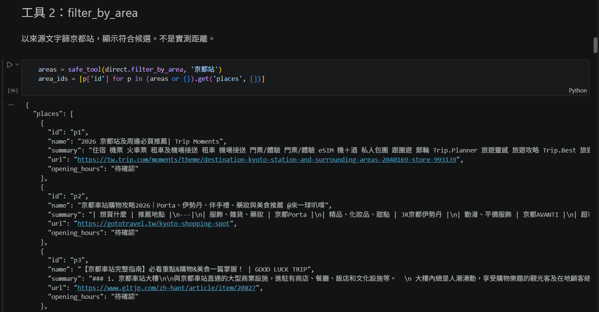

依來源文字從已有候選篩選區域。這次傳入「京都站」，回傳 `p1`～`p5`，五筆都符合文字篩選條件。Notebook 再從回傳清單取出候選 ID，存成 `area_ids`。

### `filter_by_category`


依活動類別篩選候選。這次把 `area_ids` 分別搭配「甜點」和「購物」呼叫兩次。Notebook 完整輸出顯示，甜點回傳 `p1`～`p5`，購物回傳 `p2`～`p5`。

### `build_itinerary`

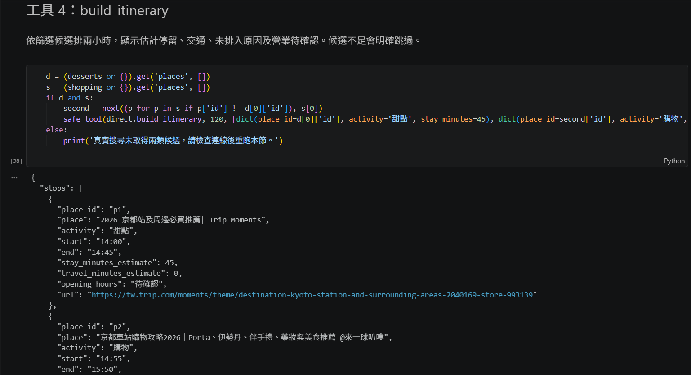

依可用時間和活動順序排程。這次傳入 120 分鐘，指定 `p1` 吃甜點 45 分鐘、`p2` 購物 55 分鐘。回傳的行程為 14:00–14:45 吃甜點、14:55–15:50 購物，含 10 分鐘移動共用 110 分鐘，沒有未排入的站點。

### `export_itinerary`


將最近一次排好的行程和來源存成 Markdown。這次呼叫不需傳入參數，回傳檔案路徑（相對於 README 為 `result/quiz1/itinerary_20261125_175345_204386_8ff04b6f.md`）和編碼 `UTF-8`。

工具與 Agent 迴圈放在 [other_code/quiz1.py](./other_code/quiz1.py)。Notebook 會顯示工具名稱、參數、回傳結果、耗時和來源。

## ReAct 流程與工具觀察

這份作業用 Qwen3 的聊天模板實作 ReAct。模型產生工具名稱和參數，Python 執行後把結果交回模型，模型再根據結果決定下一步。例如在 B1，模型可以先搜尋京都站附近的候選地點，再依搜尋結果篩選或排行程，最後按使用者要求匯出。

最初執行 A1、A2、B1、B2 時，「五工具覆蓋檢查」顯示四題合計用了四個工具，缺少 `filter_by_area`。搜尋關鍵字包含「京都站」，但工具紀錄裡沒有實際的區域篩選呼叫。

因此在 A1 的提示中明確要求模型呼叫 `filter_by_area` 確認京都站。重跑後，工具紀錄顯示模型確實以 `area="京都站"` 呼叫了該工具。

### 模型可呼叫的函數與實際覆蓋

Quiz 1 每輪把 `TOOLS` 裡的 **5 個函數定義**交給 Qwen3 的聊天模板，包括 `search_places`、`filter_by_area`、`filter_by_category`、`build_itinerary` 和 `export_itinerary`。定義中包含用途與參數，模型可以依題目選用。這是[程式註冊的工具清單](./other_code/quiz1.py#L127)；四題實際成功呼叫了哪些工具，另由 Notebook 的「五工具覆蓋檢查」統計。

```text
成功呼叫: ['build_itinerary', 'export_itinerary', 'filter_by_area', 'filter_by_category', 'search_places']
尚缺: []
```

### 任務成果與失敗案例

以下使用 [Notebook](./main.ipynb) 已存的四題執行結果。A1、A2 是找甜點店的兩種問法，B1、B2 是安排兩小時行程並匯出的兩種問法。

#### A1｜搜尋甜點店並附來源

**輸入**：「幫我找京都站附近的甜點店，附上來源。」

**實際輸出**：搜尋回傳 5 筆候選與來源網址，區域篩選回傳 4 筆。模型之後嘗試排行程和匯出，匯出工具因題目沒有要求存檔而拒絕。最終回答停在存檔提醒，沒有整理甜點店建議，也沒有產生檔案。

#### A2｜用口語詢問甜點店

**輸入**：「我在京都車站周邊想吃點甜的，有哪些地方可以去？」

**實際輸出**：搜尋回傳 5 筆候選與來源網址，這次區域篩選回傳空清單。模型仍嘗試排行程和匯出，最後同樣只回覆存檔提醒。沒有提供甜點店建議，也沒有產生檔案。

#### B1｜安排甜點與購物行程，並匯出 Markdown

**輸入**：「我在京都站附近只有兩小時，想先吃甜點再逛街，幫我排行程並存成Markdown。」

**實際輸出**：成功搜尋並篩選候選、排行程與匯出。行程包含 14:00–14:30 的甜點活動、15 分鐘移動，以及 14:45–15:30 的購物活動，共 90 分鐘，沒有未排入的站點。匯出的檔案也列出來源網址和待確認事項。

**成果檔**：[B1 匯出的京都站行程（Markdown）](./result/quiz1/itinerary_20261125_175430_207257_3913f8bf.md)

#### B2｜換一種問法安排 120 分鐘行程

**輸入**：「幫我安排京都車站周邊的120分鐘行程，順序是甜點、購物，最後匯出成Markdown檔。」

**實際輸出**：搜尋回傳 5 筆候選與來源網址，但區域篩選回傳空清單。模型也把「甜點、購物」整串當成一個 `category` 傳給只比對單一類型的工具，再次得到 `places: []`。最終回覆表示找不到符合條件的單店，後續沒有排程或匯出，因此沒有成果檔。這次失敗顯示兩種活動應分開篩選。

## 進階比較結果與觀察

### 三種提示技巧

兩個模型都使用同一份搜尋候選和同一個任務：「我在京都站附近只有兩小時，想先吃甜點再逛街，幫我排行程並存成Markdown。」每組建立新對話，搭配下列其中一種[額外提示](./other_code/quiz1.py#L216)。

1. **直接指令**只交代目標與使用工具的原則，讓模型自行安排步驟。實際提示：「完成任務，使用必要工具。」
2. **角色與輸出要求**設定模型的身分，並列出答案要包含的欄位。實際提示：「你是謹慎的旅遊規劃師。輸出時間表、估計時間、來源、待確認事項及匯出路徑。」
3. **單一示範案例**用另一個城市的類似任務示範處理方法。實際提示：「示例：大阪站90分鐘先咖啡再購物並存檔。助手搜尋大阪站候選，篩選區域及咖啡／購物，依候選ID排90分鐘行程，匯出並附來源路徑。此為方法示例，不是本題資料。」

### 六組比較結果

下表整理 [main.ipynb](./main.ipynb) 已儲存的六組比較結果。

| 模型 | 提示技巧 | 工具呼叫次數 | 耗時（秒） | 完成 |
| --- | --- | ---: | ---: | --- |
| Qwen3-1.7B | 直接指令 | 8 | 20.4 | False |
| Qwen3-1.7B | 角色與輸出要求 | 7 | 26.876 | False |
| Qwen3-1.7B | 單一示範案例 | 7 | 20.63 | False |
| Qwen3-0.6B | 直接指令 | 5 | 17.163 | False |
| Qwen3-0.6B | 角色與輸出要求 | 5 | 8.214 | False |
| Qwen3-0.6B | 單一示範案例 | 5 | 7.765 | False |

六組的工具順序都列出五種工具，包含 `build_itinerary` 和 `export_itinerary`。這只表示模型曾嘗試呼叫，排程和匯出是否成功須看各工具的回傳結果。耗時是這次各組的執行紀錄，單憑耗時無法判斷模型或提示技巧的優劣。

[compare()](./other_code/quiz1.py#L221) 要求以下條件全部成立才算完成。

- 整輪沒有錯誤，且有最終回答。
- 有匯出紀錄。
- 最後一次排程沒有省略任何站點，估計總耗時不超過 120 分鐘。
- 行程至少有兩站，前兩站的活動依序符合「甜點」和「購物」。
- 工具呼叫紀錄包含全部五種工具。

### ReAct 流程解讀：Qwen3-1.7B「直接指令」

這組共有 **8 次工具呼叫，耗時 20.4 秒**。每輪由模型提出工具與參數，Python 執行並把實際結果交回模型。下表依 Notebook 保存的輪次整理。

| 輪次 | 模型的動作 | 工具回傳與後續發展 |
| --- | --- | --- |
| 1 | 呼叫 `search_places`，搜尋京都站附近的甜點和逛街地點。 | 工具從六組共用的搜尋快照回傳 5 筆候選（`p1`～`p5`）。 |
| 2 | 同一輪提出兩次區域篩選、兩次類型篩選和一次排程。 | 兩次區域篩選都回傳空清單；甜點篩選回傳 5 筆，逛街篩選回傳 `p2`。排程指定甜點 30 分鐘、移動 15 分鐘、逛街 90 分鐘，合計 135 分鐘，工具因此只保留甜點一站。 |
| 3 | 收到上一輪的結果後，再次呼叫 `build_itinerary`。 | 第二次仍傳入相同的停留和移動時間，逛街站依然排不進 120 分鐘。 |
| 4 | 呼叫 `export_itinerary` 存下目前的行程。 | 工具回傳 [實際匯出的 Markdown](./result/quiz1/itinerary_20261125_175511_142303_9856772f.md)，模型在最終回答中附上該路徑。 |

模型收到時間不足的回傳後，重試時沿用了原本的時間分配。因此存檔雖然成功，檔案只含甜點一站，仍有站點未排入，完成欄為 `False`。其餘五組只保留比較摘要，無法從現有紀錄確定各自未通過哪一項。

## 環境設定與執行

沿用 MMIP 中已有的 PyTorch。Notebook 會透過 `from_pretrained` 載入模型。第一次執行某個模型會從 Hugging Face 下載權重到預設快取（使用者家目錄下的 `.cache/huggingface/hub`），之後會重用。Windows 上權重下載會驗證 HTTPS 憑證並使用系統信任的憑證。模型一次載入一個。顯示記憶體不夠時會改用 CPU，速度可能較慢。

在專案根目錄的 `./.env` 設定 Tavily 金鑰。

```dotenv
TAVILY_API_KEY=你的Tavily金鑰
```

`.env` 已列入 `.gitignore`。Tavily 使用 `search_depth="basic"`。

`MODEL` 預設為 `Qwen/Qwen3-1.7B`，進階比較另用 `Qwen/Qwen3-0.6B`。只重跑比較時，執行「設定與匯入」、「兩個模型 × 三種提示技巧」和「討論六組結果與解讀 ReAct」即可。六組共用同一份真實搜尋結果，已有工具展示的候選就沿用，否則只搜尋一次。

## 匯出與驗證

行程會存到 `./result/quiz1/itinerary_*.md`。每次匯出使用不同檔名，方便保留各次結果。

# quiz 2

多模態影像 Agent 使用官方 [Qwen/Qwen2.5-VL-3B-Instruct](https://huggingface.co/Qwen/Qwen2.5-VL-3B-Instruct)，透過 Transformers 在 MMIP Notebook kernel 的 CUDA GPU 上推論。模型接收實際圖片與文字指令，每輪依工具回傳和影像決定下一個動作。影像處理由 Python 和 OpenCV 執行，工具與 Agent 放在 [other_code/quiz2.py](./other_code/quiz2.py)。

## 影像工具

以下三張截圖來自 `_synthetic` 重跑的直接呼叫。實拍成果另以 `set1` 展示。

### `match_exposure`

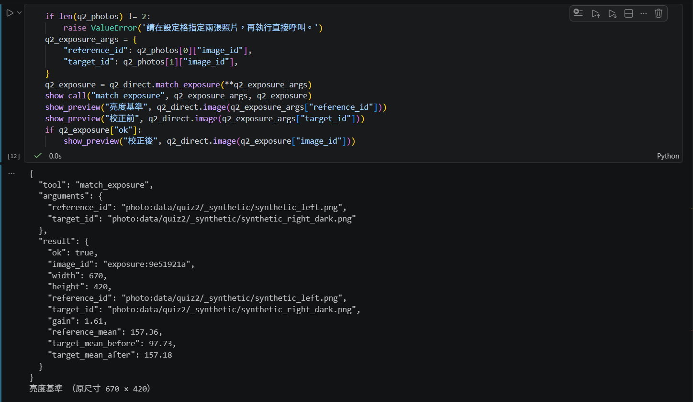

以參考圖的平均亮度校正目標圖。截圖中傳入合成左圖與較暗的合成右圖，亮度增益為 1.61，右圖的平均亮度從 97.73 調到 157.18，接近左圖的 157.36。工具回傳校正後的圖片 ID `exposure:9e51921a` 及尺寸 670 × 420。

### `stitch_images`

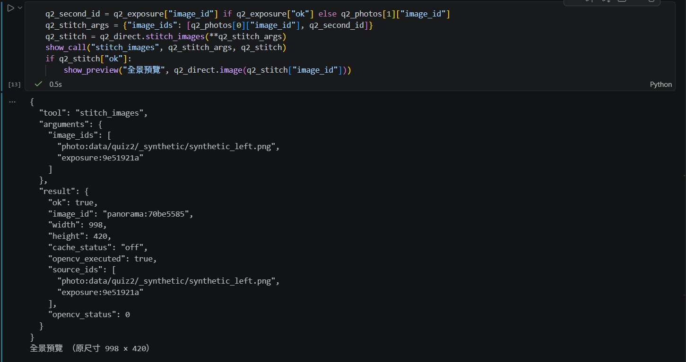

用 OpenCV 對齊並拼接有重疊的影像。截圖中傳入合成左圖與校正後的右圖。這次關閉快取，OpenCV 回傳狀態 `0`，產出 998 × 420 的全景，圖片 ID 為 `panorama:70be5585`。失敗時工具會回傳狀態和原因。

### `save_image`

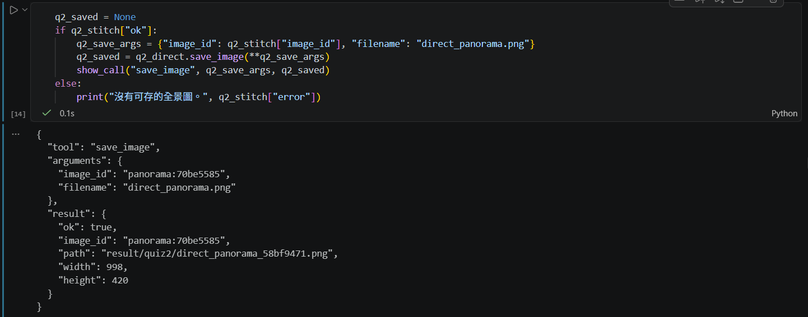

將處理結果以 PNG 存到 `result/quiz2/`。截圖中傳入全景 ID `panorama:70be5585`，指定檔名 `direct_panorama.png`。工具回傳實際檔案路徑與尺寸 998 × 420。[截圖中的合成全景 PNG](./result/quiz2/direct_panorama_58bf9471.png)

### `get_local_photos`

從指定的專案內資料夾讀取可用照片，回傳檔名、相對路徑與圖片 ID。9 工具版以這些候選作為後續看圖和拼接的輸入。

### 模型可呼叫的函數與實際執行

Quiz 2 會把註冊工具的名稱和用途寫入 Qwen2.5-VL 的系統提示。以下數量來自兩次執行輸出的 `registered_tools`，右欄是該次紀錄中模型實際成功呼叫的函數。五個旅遊工具仍列於清單中，這次照片任務只授權執行影像工具。

| 展示 | 註冊給模型的工具 | 實際成功呼叫 |
| --- | --- | --- |
| **8 工具版**：指定兩張照片 | Quiz 1 的 5 個工具，加上 `match_exposure`、`stitch_images`、`save_image`。 | `match_exposure` → `stitch_images` → `save_image` |
| **9 工具版**：指定資料夾 | 上述 8 個，再加 `get_local_photos`。 | `get_local_photos` → `match_exposure` → `stitch_images` → `save_image` |

9 工具版會列出可讀候選，並傳入檔名排序的前八張供模型看圖。本次紀錄中，模型第一輪只收到資料夾，取得照片後第二輪收到兩張圖。全景預覽見下方「基礎題驗證結果」。

## 照片、模型與執行方式

1. 將同一場景有重疊的正式照片放在 `data/quiz2/`。在 [main.ipynb](./main.ipynb) 末尾的 Quiz 2 執行「設定照片」。正式展示時，將 `q2_use_synthetic` 設為 `False`，並把 `q2_names` 設成兩張照片的檔名。若只跑 9 工具版，只需設定 `q2_folder` 並將 `q2_names` 設為空 tuple `()`。預設的合成測試影像放在 `data/quiz2/_synthetic/`。
2. 依序執行「直接呼叫 1：亮度校正」、「直接呼叫 2：全景拼接」與「直接呼叫 3：PNG 存檔」，可查看各格的實際參數、回傳與預覽。
3. 執行「載入視覺語言模型」，再執行「8 工具版：指定兩張照片」與「9 工具版：只指定資料夾」。最後的 PNG 都存到 `result/quiz2/`。

首次載入會從 Hugging Face 官方模型庫下載權重與 processor。模型檔、下載暫存和 CUDA 快取都放在 `.cache/quiz2/huggingface/`。重跑會沿用這份 Quiz 2 專用模型快取。

## 基礎題驗證結果

### 實拍輸入

下方基礎題、直接呼叫快取對照和 Agent 快取驗證都使用 `data/quiz2/set1/` 的兩張實拍照片。

| `left.jpg`（參考圖） | `right.jpg`（待校正圖） |
| --- | --- |
| 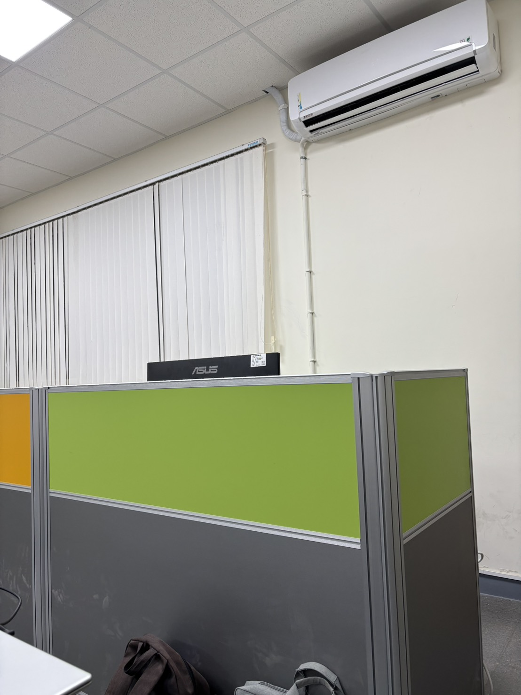 | 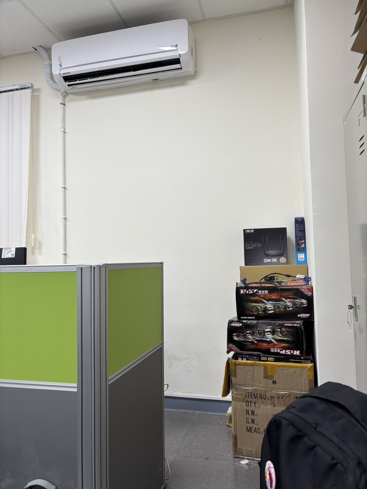 |

### `set1` 實拍結果

直接呼叫以左圖為基準（平均亮度 150.15），將右圖的平均亮度由 152.72 調為 149.69，再拼接並存成 PNG。8 工具版直接收到兩張原圖，9 工具版先從資料夾取得兩張照片。兩個 Agent 都成功執行亮度校正、拼接與存檔。

| 展示 | 輸入 | 全景尺寸 | 匯出 |
| --- | --- | --- | --- |
| 直接呼叫 | 左圖與校正後的右圖 | 1776 × 1369 | [全景 PNG](./result/quiz2/direct_panorama_07f0deb9.png) |
| 8 工具版 | 指定 `left.jpg`、`right.jpg` | 1776 × 1369 | [全景 PNG](./result/quiz2/agent8_panorama_ffdd1cb0.png) |
| 9 工具版 | 指定資料夾 `data/quiz2/set1` | 1773 × 1369 | [全景 PNG](./result/quiz2/agent9_panorama_2160510f.png) |


### `set3` 拼接失敗

用 `set3` 的左右兩張照片重現直接拼接。亮度校正成功，右圖增益已達 4.0，平均亮度仍只有 29.46，低於左圖的 85.20。OpenCV 對齊時找不到足夠可配對的重疊特徵，回傳狀態 `1`，工具訊息為「可配對的重疊影像不足」。這次直接呼叫沒有產生全景，也沒有可供存檔或寫入快取的結果。

## 進階：拼接快取

`stitch_images` 預設關閉快取。可用 `ImageTools(stitch_cache=True)` 開啟，Agent 則可用 `ImageAgent(..., stitch_cache=True)` 開啟，工具名稱和呼叫參數相同。快取鍵由實際送入 OpenCV 的 BGR 像素、尺寸、資料型別、輸入順序、OpenCV 版本與拼接模式產生。亮度校正過的照片會用校正後的像素計算。

成功拼接的全景會以快取鍵為檔名保存成 PNG，放在 `result/quiz2/cache/`。同樣的輸入與設定且 PNG 可讀時，會直接讀回全景並取得本輪可用的圖片 ID。PNG 損壞時會重新拼接，拼接失敗不會寫入快取。快取是供後續拼接重用的中間結果，正式匯出仍用 `save_image` 把選定的成品另存到 `result/quiz2/`。

`set1` 右圖只校正一次，三次都依相同順序輸入左圖與校正後的右圖。表中耗時只計 `stitch_images`，包含快取查找與 PNG 讀寫。

| 快取狀態 | 耗時（秒） | 實際執行 OpenCV | 全景尺寸 | 與 off 的像素一致 |
| --- | ---: | --- | --- | --- |
| off | 0.638126 | 是 | 1773 × 1369 | 是（基準） |
| miss | 1.029151 | 是 | 1776 × 1369 | 否 |
| hit | 0.115429 | 否 | 1776 × 1369 | 否 |

off 與 miss 是兩次獨立拼接，這次的尺寸和像素有差異。hit 讀回的全景與 miss 寫入前逐像素一致。

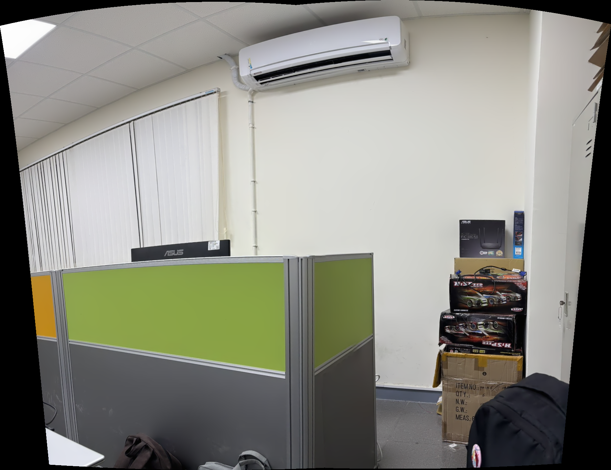

重測時，依序執行 Notebook 末尾「進階：拼接快取」的兩格。準備格每次建立新的測試快取路徑，舊成果會保留。

### Agent 快取驗證

兩個新 Agent 都依序收到 `set1` 的左圖和同一張校正後的右圖，共用新建的快取子目錄，並各自呼叫 `stitch_images`、`save_image`。Notebook 準備格仍印著「合成測試圖」，實際讀取的是 `q2_folder`、`q2_names` 指定的 `set1`，快取鍵與上方直接呼叫對照相同。

| 執行 | 快取狀態 | 實際執行 OpenCV | 拼接工具耗時（秒） | 正式匯出像素比對 | 匯出成果 |
| --- | --- | --- | ---: | --- | --- |
| 第一次 | miss | 是 | 1.037 | 第一次輸出為基準 | [第一次全景 PNG](./result/quiz2/agent_cache_panorama_2f104f97.png) |
| 第二次 | hit | 否 | 0.094 | 與第一次逐像素一致 | [第二次全景 PNG](./result/quiz2/agent_cache_panorama_f529f456.png) |

兩份正式匯出與共用的快取 PNG 都是 1774 × 1368，三者逐像素一致。


重測時依序執行 [main.ipynb](./main.ipynb) 的「Agent 快取驗證」準備格、「執行兩次 Agent 對話」和「核對拼接與輸出」。準備格會指定新的空快取路徑，模型沿用 Quiz 2 的本機權重。

## 進階：語音對話

語音模式沿用 9 工具版，再加入由語音流程固定呼叫的第 10 和第 11 個函數。Notebook 設定格會列出 11 個函數。每筆工具紀錄的 `source` 標示呼叫是由 `voice_workflow` 觸發，還是由 `qwen_model` 選擇。

| 階段 | 分工 |
| --- | --- |
| 語音輸入 | 第 10 個函數 `speech_to_text(audio_path)` 使用 Transformers 和多語版 [OpenAI Whisper Small](https://huggingface.co/openai/whisper-small)，把專案內的中文 WAV 轉成文字。 |
| 影像處理 | Qwen2.5-VL 接收 Whisper 實際轉錄的文字。只提供資料夾時，第一輪先呼叫 `get_local_photos`，再根據實際影像和工具回傳選擇校正、拼接與存檔。 |
| 語音回覆 | 第 11 個函數 `text_to_speech(text)` 使用 [Piper 中文 huayan 聲音](https://huggingface.co/rhasspy/piper-voices/tree/main/zh/zh_CN/huayan/medium) 的 `.onnx` 和 `.onnx.json` 合成 WAV。只有拼接結果經 Agent 存成可讀的 PNG，回覆才會說「全景圖已存檔」。 |

語音權重、下載暫存及 Piper 資源都放在 `.cache/quiz2/audio/`，全景 PNG 和回覆 WAV 存到 `result/quiz2/`。

語音指令可用自己的說法，並在同一句裡指定要做或略過的步驟，例如「保留原本亮度，直接接成全景後存檔」或「先把右圖的亮度調得接近左圖，只存校正後的右圖」。Qwen 依 Whisper 的完整轉錄選工具。回覆會綜合實際工具紀錄，說明完成的步驟、未完成的要求和已知原因。程式另外核對 PNG 是否可讀，再決定如何播報存檔狀態。

### 執行方式

1. 在 [main.ipynb](./main.ipynb) 末尾的「進階：語音對話」設定格，把 `q2v_audio_path` 設成自己的 WAV 相對路徑，預設是 `data/quiz2/voice_command.wav`。錄音可說「請把這個資料夾裡兩張有重疊的照片拼成全景圖並存檔」。`q2v_photo_folder` 未指定時沿用基礎題的照片資料夾設定，沒有已執行的設定時使用原來的兩張合成圖。
2. 執行「執行語音指令並播放回覆」。如果 WAV 不存在且開啟 `q2v_allow_synthetic`，具備 Piper 依賴時會先合成一段測試指令，並標為合成語音。「獨立驗證中文轉錄」只用於試聽樣本，可跳過。

### 本次實測

| 錄音 | Whisper 轉錄 | 結果 | 輸出 |
| --- | --- | --- | --- |
| [一般拼接指令](./data/quiz2/voice_command.wav) | 請把這兩張照片拼成全景圖,然後存檔 | 成功讀取 `set1` 兩張原圖，直接拼接並存成 1744 × 1363 的全景。語音回覆確認已存檔。 | [全景 PNG](./result/quiz2/panorama_2a6b50f0.png) · [回覆 WAV](./result/quiz2/voice_15a6fd6fddfe.wav) |
| [保留亮度指令](./data/quiz2/voice_no_exposure.wav) | 保留原本圖片亮度把照片拼在一起 | 成功讀取 `set2` 的兩張原圖，未做額外亮度校正。OpenCV 拼接失敗，只有語音回覆。 | [失敗回覆 WAV](./result/quiz2/voice_cc9980f45504.wav) |

一般拼接指令的重跑紀錄保存在 [Notebook](./main.ipynb)，實際順序為 `speech_to_text` → `get_local_photos` → `stitch_images` → `save_image` → `text_to_speech`。Qwen 取得 `set1` 的 `left.jpg` 與 `right.jpg` 後直接拼接，沒有額外亮度校正。這次關閉快取，OpenCV 回傳狀態 `0`。Piper 回覆「已讀取 2 張照片。已拼成全景圖。全景圖已存檔。」，WAV 長度 4.957 秒。

保留亮度指令沿用前次存檔核對的紀錄，順序為 `speech_to_text` → `get_local_photos` → `stitch_images` → `text_to_speech`。Qwen 取得 `set2` 的 `left.jpg` 和 `right.jpg` 後直接拼接，OpenCV 回傳狀態 `1`「可配對的重疊影像不足」。這代表該次無法從兩張原圖找到足夠的可配對重疊特徵。拼接未產生全景，因此沒有呼叫 `save_image`。Piper 正常生成回覆，說明已讀取兩張照片、未能完成拼接，且沒有匯出圖片。

# quiz 3

Quiz 3 在現有 MMIP GPU kernel 沿用 Qwen2.5-VL。每輪由模型選擇讀取 Skill、呼叫 Function、盤點 Function、自行撰寫與執行 Python，或結束。執行器會把工具回傳或實際錯誤交回模型。比較圖的配置、縮放方式和視覺樣式由該輪模型寫進腳本。

## 註冊的 Skill 與 Function

| Skill | 用途 |
| --- | --- |
| [panorama-workflow](./.agents/skills/panorama-workflow/SKILL.md) | 讀取本機照片、依需求校正或保留亮度、依左到右拼接、存檔並驗證。 |
| [image-comparison-report](./.agents/skills/image-comparison-report/SKILL.md) | 將左原圖、右原圖及已存檔的全景排成比較圖。每張標註原始像素尺寸，最後回讀並驗證 PNG。 |

| 類別 | 實際註冊的 Function |
| --- | --- |
| 旅遊（5） | `search_places`、`filter_by_area`、`filter_by_category`、`build_itinerary`、`export_itinerary` |
| 影像（4） | `match_exposure`、`stitch_images`、`save_image`、`get_local_photos` |
| 語音（2） | `speech_to_text(audio_path)`、`text_to_speech(text)` |

語音的兩個 Function 綁定 Quiz 2 的 Whisper 與 Piper，可由 Quiz 3 模型直接選用。本次三圖比較只需影像工具，沒有呼叫語音或旅遊 Function。生成腳本在子程序執行，只能用開放的 Python 語法與 Pillow 操作，讀取本輪指定的三張圖並寫到指定 PNG。

## VS Code Codex 測試

兩項 Skill 測試均已在遠端 VS Code Codex 完成。第二項使用第一項實際產出的全景。以下的截圖、重跑腳本與成果均來自 `result/quiz3/codex/`。[原始測試指令](./result/quiz3/codex/test-plan.md)

### 測試 1：`$panorama-workflow`

Codex 讀取 Skill 後，依左、右順序登錄 `set1` 的兩張原圖，跳過 `match_exposure`，使用 Quiz 2 的 `stitch_images` 和 `save_image`。首次啟動發生 `ModuleNotFoundError: No module named 'other_code'`，將專案根目錄加入 `sys.path` 後重跑成功。OpenCV 回傳狀態 `0`，回讀確認全景為 **1774 × 1368** 的 RGB PNG。

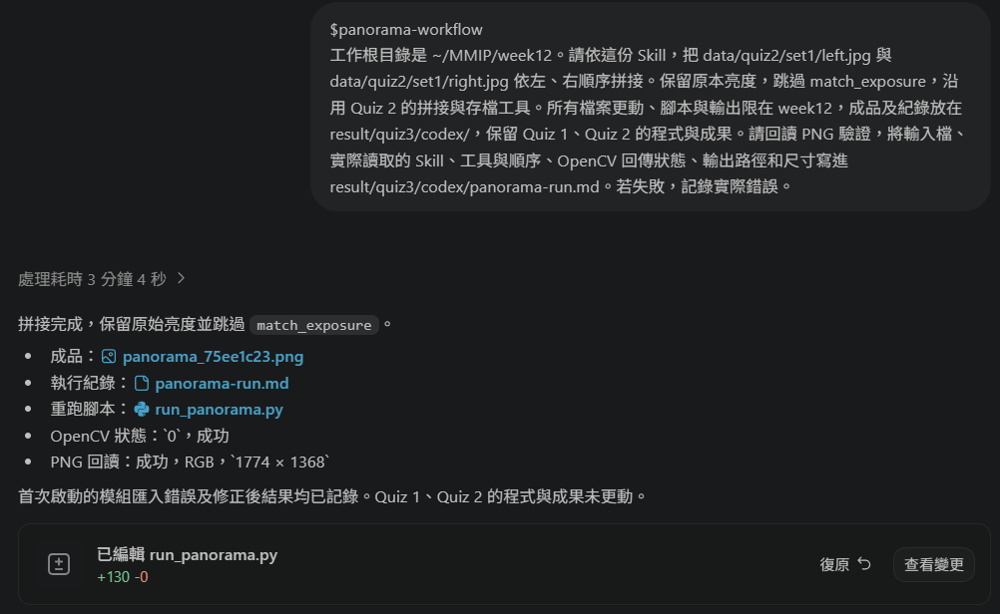

[全景 PNG](./result/quiz3/codex/panorama_75ee1c23.png) · [執行紀錄](./result/quiz3/codex/panorama-run.md) · [重跑腳本](./result/quiz3/codex/run_panorama.py)

### 測試 2：`$image-comparison-report`

Codex 讀取兩張原圖和第一輪全景，用 Pillow 腳本將左右原圖並排在上、全景置於下。尺寸標籤使用縮放前的原始像素，左右圖各為 **1108 × 1477**，全景為 **1774 × 1368**。已回讀並目視核對 **2000 × 2260** 的比較圖 PNG，三張圖與標籤皆清楚可見。

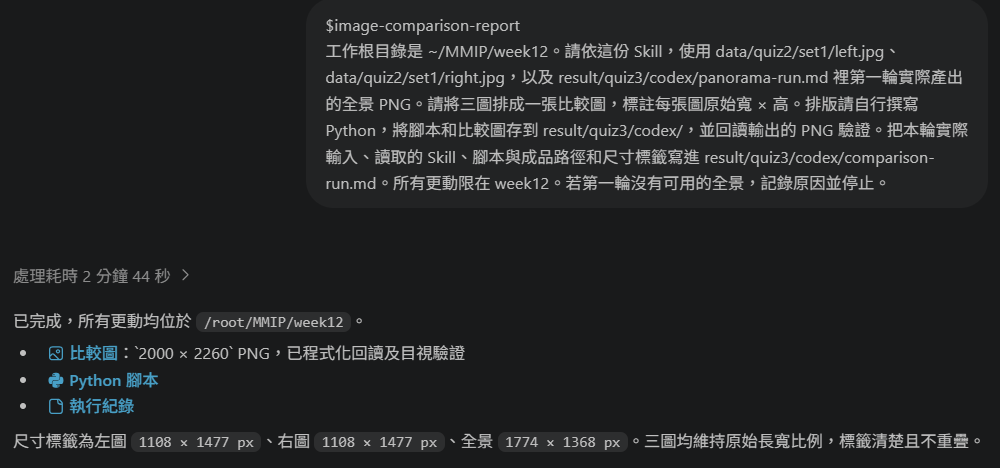

[比較圖 PNG](./result/quiz3/codex/comparison.png) · [執行紀錄](./result/quiz3/codex/comparison-run.md) · [生成的 Python 腳本](./result/quiz3/codex/create_comparison.py)

## 特化 Agent 實測｜set1

輸入照片為 [左原圖](./data/quiz2/set1/left.jpg) 與 [右原圖](./data/quiz2/set1/right.jpg)。在 [main.ipynb](./main.ipynb) 末尾依序執行 Quiz 3 的清單、Agent 執行與成果檢視。

> 請把這兩張照片左右拼接，保留原本亮度並存檔。接著把兩張原圖和全景圖排成一張比較圖，標註每張圖的原始像素尺寸，輸出 PNG。

這次執行保留原本亮度，依左、右原圖的順序呼叫 `stitch_images`，OpenCV 回傳狀態 `0`。全景為 **1774 × 1368**，比較圖為 **1995 × 778**。比較圖從左到右標示三個原始尺寸，分別為 **1108 × 1477**、**1108 × 1477**、**1774 × 1368**。

[全景 PNG](./result/quiz3/agent/run_a68e6eec5a/panorama_1579a13f.png) · [比較圖 PNG](./result/quiz3/agent/run_a68e6eec5a/comparison.png) · [模型生成的 Python](./result/quiz3/agent/run_a68e6eec5a/comparison_r07.py) · [完整 ReAct 紀錄](./result/quiz3/agent/run_a68e6eec5a/react.json)

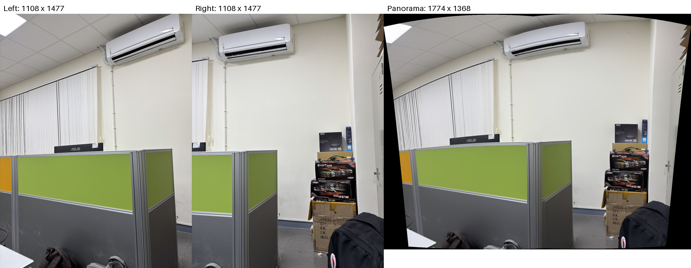

### 八輪是什麼

這次 set1 任務從開始到結束共執行 **八個 ReAct 回合**。每一輪，模型根據目前的資料選擇一個動作，流程把執行結果交回模型，供它決定下一步。以下八輪都出自同一筆 `run_a68e6eec5a` 紀錄。

| 輪次 | 實際選擇 | 決策依據與參數 | 觀察及對下一輪的影響 |
| --- | --- | --- | --- |
| 1 | `read_skill` | 讀取 `panorama-workflow`。 | 取得本機取圖、保留亮度與左右拼接的步驟。 |
| 2 | `get_local_photos` | 指定 `folder=data/quiz2/set1`。 | 回傳 `left.jpg`、`right.jpg` 與對應 ID，供拼接使用。 |
| 3 | `stitch_images` | 依左、右順序傳入兩張原圖的 ID。 | OpenCV 狀態 `0`，回傳 `panorama:1a2fa895`，供下一輪存檔。 |
| 4 | `save_image` | 傳入全景 ID，指定 `filename=panorama.png`。 | 存成 1774 × 1368 PNG，這個路徑和兩張原圖一起成為比較圖輸入。 |
| 5 | `read_skill` | 讀取 `image-comparison-report`。 | 取得三張圖、原始像素尺寸標籤及 PNG 的驗收條件。 |
| 6 | `inspect_functions` | 檢查 11 個 Function 是否支援三圖排版和尺寸標籤。 | 回傳 `comparison_layout_available=false`，模型接著選擇自行寫程式。 |
| **7** | **`write_and_run_python`** | 模型針對本輪的三張輸入生成 [comparison_r07.py](./result/quiz3/agent/run_a68e6eec5a/comparison_r07.py)。 | 腳本退出碼 `0`，回讀並驗證 1995 × 778 的 PNG、三張等比例影像與標籤。 |
| 8 | `finish` | 全景和比較圖都已通過驗證。 | 回傳兩張 PNG 的實際路徑並結束。 |

### 自行撰寫程式碼在哪裡展示

在 `main.ipynb` 的 Quiz 3「查看成果與 ReAct」輸出中，可看到「自行撰寫程式碼｜第 7 輪」及腳本連結。完整紀錄第 7 輪的 `code_generation_reply` 保存模型回傳的 Python，`observation` 保存執行退出碼、PNG 路徑及三個標籤。 [Notebook](./main.ipynb) · [實際執行的 Python](./result/quiz3/agent/run_a68e6eec5a/comparison_r07.py) · [ReAct 紀錄](./result/quiz3/agent/run_a68e6eec5a/react.json)

`write_and_run_python` 會把先前由模型生成的排版參考帶入本輪的圖片路徑與尺寸，再由模型輸出完整 Python。程式將本輪的模型回覆存成腳本，執行後回讀 PNG 驗收。 [動作實作](./other_code/quiz3.py) · [排版參考](./other_code/quiz3_layout_reference.txt)

先前的驗證曾遇到圖片 ID 錯誤、JSON 截斷、Pillow `ANTIALIAS` 不相容、全景貼圖越界，以及生成腳本沿用上一輪的全景路徑。 [JSON 截斷紀錄](./result/quiz3/agent/run_ac77a7cb6b/react.json) · [Pillow 錯誤紀錄](./result/quiz3/agent/run_85d5fd120a/react.json) · [貼圖越界紀錄](./result/quiz3/agent/run_3af0b037cc/react.json) · [路徑錯誤與修正紀錄](./result/quiz3/agent/run_e577b52b13/react.json)
