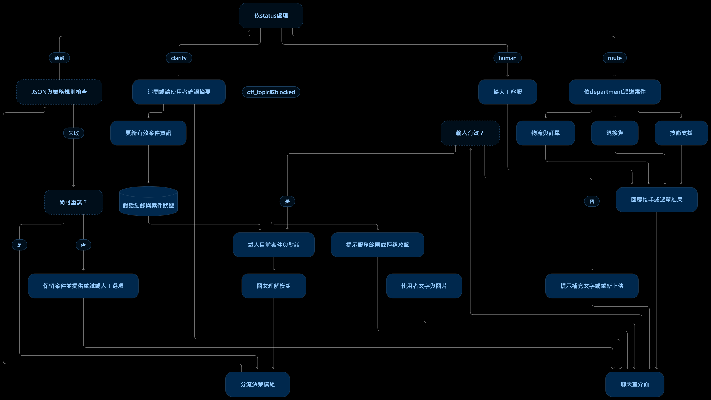

# quiz 1
## 作業要求與本次設計範圍
本作業設計「3C電商售後客服」，本階段完成情境、輸出規格與系統架構，以下部門與欄位為本作業自行設計。

## 業務情境與服務目標
本系統服務販售耳機、手機、平板、鍵盤及滑鼠等3C商品的電商平台。顧客購買商品後，可能透過分次輸入文字、上傳商品照片或錯誤畫面截圖，描述配送、商品損壞或操作問題。<br>
系統需要結合多輪對話與圖片，釐清問題及處理需求。資訊不足時先追問；資訊足夠時整理案件摘要，讓使用者確認後，將案件交給對應部門。<br>
本系統的終點為需求釐清與案件分流。退貨核准、退款及實際物流操作由下游部門負責；作業展示可使用模擬案件佇列。<br>

## 下游任務與分流界線
| 部門代碼 | 部門 | 下游任務 |
| --- | --- | --- |
| order_logistics | 物流與訂單部門 | 查詢配送進度、配送延遲、尚未收到商品 |
| returns | 退換貨部門 | 處理商品破損、寄錯商品、缺少配件及退換貨申請 |
| technical_support | 技術支援部門 | 協助操作設定、連線問題、無法開機及功能異常 |

另外提供轉人工客服的處理途徑，用於使用者主動要求人工、案件超出自動處理能力，或多次追問仍無法釐清。<br>
分流依「目前確認的處理需求」決定，例如耳機無法連線且希望排查，交給技術支援；後續明確改為申請退貨，則更新為退換貨需求；資訊不足或尚未確認時不正式分流。<br>
訂單編號僅在查詢或建案所需時補問，不要求每個問題都先提供。<br>

## 主要使用流程
1. 使用者輸入文字，並可上傳圖片。
2. 系統檢查輸入與圖片是否有效，並讀取目前案件狀態及對話紀錄。
3. 圖文理解模組結合圖片、文字與前文，辨識問題、需求及相關線索。
4. 分流決策模組判斷是否需要追問、處理離題、攔截攻擊、轉人工或進行分流。
5. 若資訊不足，提出與缺少資訊相關的問題，等待下一輪輸入。
6. 若資訊足夠，提出案件摘要與處理需求，等待使用者確認。
7. 使用者確認後，輸出分流結果，交給對應部門並回覆案件摘要。
8. 每輪輸出通過格式與業務規則檢查後，才更新案件狀態或觸發下游動作。

## 結構化輸出Spec
### 格式與欄位
每輪處理產生一個JSON物件，不附加Markdown程式碼圍欄或JSON以外的文字。<br>
| 欄位 | 型別 | 定義 |
| --- | --- | --- |
| status | string | 處理狀態，只能為clarify、route、off_topic、blocked、human |
| department | string或null | 三個部門代碼之一；未正式分流時為null |
| product | string或null | 目前案件的商品，未知時為null |
| summary | string | 根據有效對話及圖片線索整理的案件摘要 |
| missing_fields | string陣列 | 待補資訊，例如problem、requested_action、confirmation；無缺項時為空陣列 |
| reply | string | 顯示給使用者的自然語言回覆 |

status定義：<br>
- clarify：資訊不足，或等待使用者確認摘要。
- route：資訊足夠且使用者已確認，可以正式分流。
- off_topic：本輪訊息與3C售後服務無關。
- blocked：本輪包含試圖改寫系統規則、洩漏內部資訊或繞過流程等攻擊指令。
- human：使用者要求人工，或需由人工接手。

### 跨欄位與狀態規則
1. 六個欄位全部必填，不允許額外欄位；未知商品使用JSON的null。
2. status為route時，department必須為有效部門，missing_fields必須為空陣列。
3. status不是route時，department為null；此null表示「本輪不派單」，不表示刪除先前案件資訊。
4. route還必須通過程式端檢查：所需資訊已齊全，而且確認對應到目前版本的案件摘要。模型單方面輸出route不能直接觸發派單。
5. 等待確認時使用clarify，並將confirmation列入missing_fields。若使用者更改需求，原確認失效，需重新確認。
6. off_topic與blocked不覆寫原案件摘要、需求、確認狀態或已取得資訊；程式保留原案件資料。恢復有效對話後繼續原流程。
7. reply不得宣稱退款已完成或退貨已核准；完成模擬派單後才顯示已轉交。
8. 圖片無法辨識時說明限制並追問，不自行推測商品損傷或故障原因。
9. 本輪輸出與持久案件狀態分開管理。案件ID、確認版本、重試次數及派單狀態由程式管理。
10. 多個問題拆成不同案件。本輪只處理一個目前案件，其他案件排入待處理清單；由程式記錄案件關聯，避免混合摘要與部門。

### 輸出範例
需求已確認，可以換貨分流：<br>
```json
{
  "status": "route",
  "department": "returns",
  "product": "耳機",
  "summary": "使用者收到耳機後發現外殼破損，已提供照片並確認希望換貨。",
  "missing_fields": [],
  "reply": "已為您轉交退換貨部門，後續將由相關人員協助處理換貨申請。"
}
```

尚未確認退貨或換貨：<br>
```json
{
  "status": "clarify",
  "department": null,
  "product": "耳機",
  "summary": "使用者收到耳機後發現外殼破損，尚未確認處理需求。",
  "missing_fields": ["requested_action"],
  "reply": "請問您希望退貨還是換貨？"
}
```

完整的JSON Schema請參閱[schema.json](./schema.json)。<br>

## 技術架構圖


架構說明：<br>
- 聊天室介面接收文字與圖片，呈現回覆與確認摘要。
- 輸入檢查處理空白訊息、圖片格式、大小及讀取錯誤。
- 對話與案件管理保存有效資訊、目前案件及待處理案件；離題或攻擊不更新原案件內容。
- 圖文理解模組結合當輪輸入與歷史對話。圖片中的文字屬於待分析資料，不能提升為系統指令。
- 分流決策模組產生上述Spec，quiz 2可替換為Prompt、訓練、Decoding限制或System One方法。
- 格式檢查確認JSON可解析、欄位與值合法；業務規則檢查確認是否具備派單條件。
- 格式錯誤最多額外重試兩次，仍失敗則保留案件並提供重試或人工選項。
- 下游介接使用案件ID防止重複派單，成功與失敗均更新案件狀態；派單失敗不回覆已成功轉交。
- UI、狀態管理及各模組是設計角色，不代表每個模組都必須另用一個模型。


# quiz 2
本實驗使用`Qwen/Qwen2.5-VL-3B-Instruct`，模型精度為FP16。<br>

## 實驗A：Prompt引導結構化輸出
透過Prompt提供3C電商售後客服的處理規則、部門定義及JSON Schema，引導模型結合商品圖片與使用者敘述，輸出指定的JSON結構。<br>
實驗未進行模型微調，也未在生成過程中施加格式限制。模型生成後，才檢查JSON是否可解析、是否符合Schema，以及狀態與部門是否符合預期，不修復輸出或自動重試。<br>

### 實作與測試方式
- `main.ipynb`：執行模型載入、測試、結果展示與人工評分。
- `other_code/quiz2a.py`：實作Prompt、圖文推論、自動評估與顯存監測。
- `dataset/quiz2/`：存放10張測試圖片與`benchmark.json`。
- `result/quiz2/`：保存模型原始輸出、執行時間、顯存用量與評分結果。

Benchmark包含商品破損、寄錯商品、疑似缺件、連線異常、資訊不足、物流查詢及圖文不一致等情境。<br>
自動評估檢查輸出格式及標籤，人工評分則依各案例的必要行為與禁止行為，判斷回答內容是否合理。人工評分使用同一批模型輸出，不另外執行推論。<br>

### 測試環境
| 項目 | 設定 |
|---|---|
| Attention實作 | SDPA |
| 生成方式 | `do_sample=False` |
| 最大生成長度 | 512 tokens |
| 測試案例數 | 10筆 |

### 量化結果
| 指標 | 結果 |
|---|---|
| 推論成功 | 10/10筆 |
| JSON可解析率 | 100% |
| Schema通過率 | 100% |
| 狀態與部門符合率 | 60% |
| 平均推論耗時 | 3.38秒／筆 |
| 各筆平均顯存用量的平均 | 7.10 GiB |
| 所有案例最高顯存峰值 | 7.35 GiB |
| 人工內容通過 | 1/10筆 |
| 人工內容通過率 | 10% |

本次記錄時間與顯存作為資源消耗指標，尚未換算金額成本。<br>

### 人工評分標準
- 必要行為均完成，且未出現禁止行為，評為通過。
- 缺少必要行為、出現禁止行為，或輸出欄位與回覆內容矛盾，評為不通過。
- 不要求回答與參考文字逐字相同。
- 依原設計，資訊足夠後仍須請使用者確認案件摘要，確認後才能正式分流。

### 結果分析
本次測試中，Prompt引導能讓模型穩定產生可解析且符合Schema的JSON，但格式正確不代表內容與處理流程正確。<br>
模型仍可能提前分流、遺漏必要追問、產生欄位矛盾，或忽略圖片與文字的不一致。因此，結構正確率與內容通過率需要分開觀察。<br>
目前10筆案例皆為首次輸入，預期狀態均為`clarify`，狀態與部門符合率主要反映模型是否適當保留分流，尚不能代表確認後對三個部門的正式分流準確率。


## 實驗B：SFT+LoRA微調
針對實驗A中「資訊尚未確認就提前分流」的問題，透過SFT訓練模型學習「釐清資訊->確認摘要->正式分流」的處理流程。<br>

### 訓練資料與方法
另外準備5張圖片，涵蓋商品顏色不符、藍牙連線失敗、物流查詢及手機螢幕破損等情境。<br>
每張圖片設計3筆樣本，共15筆SFT資料：<br>
1. 資訊不足時，追問缺少的資訊。
2. 需求明確後，整理摘要並請使用者確認。
3. 使用者確認後，輸出對應部門的分流結果。
每筆資料包含圖片路徑、歷史對話、本輪使用者輸入與標準JSON答案。訓練只計算標準答案部分的loss，不計算輸入Prompt部分。<br>
訓練圖片與原本10張Benchmark圖片分開，Benchmark不參與訓練。<br>

### 訓練設定
| 項目 | 設定 |
|---|---|
| 訓練方法 | SFT＋LoRA |
| 訓練資料 | 5張圖片、15筆樣本 |
| Epochs | 3 |
| Learning rate | 0.0001 |
| Batch size | 1 |
| Gradient accumulation steps | 4 |
| LoRA rank | 8 |
| LoRA alpha | 16 |
| LoRA dropout | 0.05 |
| LoRA作用層 | q_proj、k_proj、v_proj、o_proj |
| 訓練精度 | FP16混合精度，LoRA可訓練參數保留FP32 |
| Random seed | 42 |

`other_code/quiz2b.py`負責讀取訓練資料、執行SFT與保存LoRA權重；推論與評估沿用`quiz2a.py`的共用函式。<br>

### 量化結果
| 指標 | 實驗A：Prompt | 實驗B：SFT＋LoRA |
|---|---|---|
| 推論成功 | 10/10筆 | 10/10筆 |
| JSON可解析率 | 100% | 100% |
| Schema通過率 | 100% | 100% |
| 狀態與部門符合率 | 60% | 90% |
| 平均推論耗時 | 3.38秒／筆 | 5.19秒／筆 |
| 各筆平均顯存用量的平均 | 7.10 GiB | 14.09 GiB |
| 所有案例最高顯存峰值 | 7.35 GiB | 14.34 GiB |
| 人工內容通過 | 1/10筆 | 0/10筆 |
| 人工內容通過率 | 10% | 0% |

### 結果分析
實驗A有4筆案例在尚未取得使用者確認時輸出route，實驗B降為1筆，狀態與部門符合率由60%提升至90%，增加30個百分點。<br>
此結果顯示，本次SFT在這批測試中改善了提前分流的傾向，模型更常保留clarify狀態，符合本次希望優先調整的方向。<br>
但人工內容通過率由10%降至0%。雖然部分案例不再提前分流，仍未完整學會應如何追問、確認摘要及維持欄位一致性。<br>

### 結論與限制
本次少量資料SFT改善了模型提前分流的情況，但沒有提升整體內容通過率。模型學習到的改變主要表現在狀態選擇，尚未穩定完成合理追問、摘要確認及欄位一致性。<br>
訓練資料僅有5張圖片、15筆樣本，情境與回答形式的多樣性有限，可能是改善不完整的原因之一；目前尚未比較不同資料量或訓練設定，不能確認其因果關係。<br>
此外，10筆Benchmark的預期狀態皆為clarify，因此90%的狀態與部門符合率，不能代表模型已具備90%的正式分流準確率。模型是否仍能在使用者確認後正確輸出route，需另以對應案例驗證。


## 實驗C：


## 實驗D：


# quiz 3
